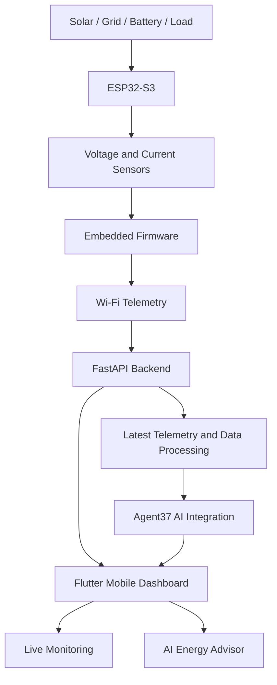

# ⚡ VoltPilot — Intelligent Energy Management, Powered by AI

<p align="center">
  <strong>One System. Smarter Energy. Better Decisions.</strong>
</p>

<p align="center">
  An AI-powered, retrofit-ready energy management platform designed to monitor energy sources, analyze consumption, manage power distribution, and transform electrical telemetry into actionable insights.
</p>

<p align="center">
  
  
  
  
</p>

---

## 🚀 Overview

Traditional power systems can provide electricity without giving users enough insight into how energy is generated, consumed, stored, or distributed.

**VoltPilot aims to bridge that gap.**

It combines embedded hardware, real-time telemetry, a mobile dashboard, and AI-powered analysis into a unified energy intelligence platform.

Instead of simply displaying voltage and current, VoltPilot is designed to help users understand their energy system through natural-language questions, consumption analysis, battery backup estimates, and intelligent recommendations.

The long-term vision is to make existing energy installations smarter through a retrofit-oriented architecture, with the potential to expand into solar-assisted backup systems, intelligent UPS solutions, and distributed energy management.

## ✨ Key Features

### 📡 1. Real-Time Energy Telemetry

Collect electrical measurements from connected hardware and transmit them to the application backend.

- Solar-source voltage and current monitoring
- Battery voltage and charging-system monitoring
- Load voltage and current monitoring
- Grid-related measurements where supported by the hardware configuration
- Relay and source-selection status
- Wi-Fi-based telemetry transmission

Measurements depend on the installed sensors, firmware configuration, and calibration.

### 🧠 2. AI Energy Advisor — Agent37

VoltPilot is designed to use Agent37 to interpret the latest available telemetry and answer user questions in natural language.

Example questions:

- *How long could my battery power the current load?*
- *How much power is the solar source contributing?*
- *Is my current energy consumption unusually high?*
- *What additional measurements are needed to estimate battery health?*
- *Explain my current energy readings in simple language.*

The AI layer can contextualize measured data, explain electrical metrics, identify missing information, and generate recommendations.

> **Engineering principle:** AI-generated estimates are not equivalent to laboratory battery-health measurements or certified electrical protection. Recommendations must be grounded in available telemetry and clearly state their assumptions.

### 📱 3. Flutter Monitoring Dashboard

A mobile interface for viewing energy information and interacting with the AI advisor.

Planned dashboard capabilities include:

- Live voltage and current cards
- Solar, battery, grid, and load monitoring
- Energy-flow visualization
- Historical trends and consumption charts
- AI-generated insights
- Natural-language question and answer interface
- Relay and device-status indicators

### 🔌 4. Embedded Hardware Control

An ESP32-S3-based prototype connects sensors and switching hardware to the software platform.

Depending on the configured firmware, the prototype can support:

- Sensor acquisition
- Relay-state monitoring and manual switching
- OLED-based status display
- Wi-Fi connectivity
- Telemetry transmission to the backend

Switching and charging features must be validated against the actual electrical design before deployment.

### 🌦️ 5. Predictive Energy Management — Roadmap

Future development aims to introduce more proactive energy decisions:

- Weather-aware solar availability estimates
- Forecast-informed charging recommendations
- Solar generation versus load-demand analysis
- Battery backup estimation
- Energy-usage anomaly detection
- Longer-term energy trends and optimization suggestions

These capabilities require appropriate data sources, validation, and sufficient historical measurements.

---

## 🏗️ System Architecture



### Architecture responsibilities

| Component | Responsibility |
|---|---|
| ESP32-S3 | Hardware interfacing, sensor acquisition, and supported control operations |
| Voltage/current sensors | Electrical measurements within their specified ranges |
| Wi-Fi | Communication between the embedded device and backend |
| FastAPI | Telemetry ingestion, API endpoints, and application integration |
| Agent37 | Natural-language interpretation and AI-assisted energy analysis |
| Flutter | Mobile visualization and user interaction |
| OLED | Local device status and measurements |

The architecture separates hardware acquisition from AI reasoning so the intelligence layer can evolve without redesigning the entire embedded system.

---

## 🧰 Technology Stack

| Layer | Technology |
|---|---|
| Embedded hardware | ESP32-S3 |
| Firmware | Arduino framework / C++ |
| Connectivity | Wi-Fi, HTTP/JSON |
| Backend | Python, FastAPI |
| API communication | REST, JSON |
| Mobile application | Flutter, Dart |
| AI integration | Agent37 |
| Display | I²C OLED |
| Data visualization | Flutter charts and dashboard components |

The exact libraries and API contracts depend on the versions and implementations used in the repository.

---

## 🔩 Prototype Hardware

The current prototype configuration includes:

- ESP32-S3 N16R8 development board
- Single-cell 3.7 V nominal 18650 lithium-ion battery
- TP4056 charging/protection module
- XL6009 boost converter
- ACS712 5 A current sensors
- 0–25 V voltage-sensor modules
- 5 V relay module
- SH1106 128 × 64 I²C OLED
- 5 V motor as a demonstration load
- Adjustable supply for solar-source simulation
- 5 V adapter for grid-source simulation
- Connecting wires and prototyping accessories

**Important:** This component list describes the prototype setup, not a certified or production-ready power system. The adjustable supply is used to simulate a solar source during demonstration; it does not establish real-world solar generation performance.

### Electrical design considerations

- Keep ESP32 GPIO voltages within the board's specified limits.
- Verify voltage-divider ratios and ADC calibration before interpreting readings.
- Validate current-sensor offsets and scaling against known measurements.
- Confirm relay module logic levels, ratings, and load compatibility.
- Ensure the battery charging arrangement has suitable protection and power-path design.
- Do not connect a motor or other inductive load without checking switching, transient, and supply requirements.

A single-cell lithium-ion battery must never be charged beyond its specified limits. A TP4056 module alone does not provide a complete system-level power-path solution.

---

## 🧠 AI-Powered Energy Intelligence

VoltPilot's AI layer is intended to do more than generate generic chatbot responses.

It receives a question alongside the latest available telemetry and uses that context to explain the system's condition.

### Example interaction

**User:**

> How much backup can my battery provide at the current load?

**VoltPilot AI Advisor:**

> I can estimate backup time using the battery's usable capacity and the load's measured power consumption. The current voltage and load readings alone are not enough for a reliable estimate. Please provide the battery capacity and confirm the measured load power. I will state the assumptions behind the estimate.

This approach prioritizes data-grounded answers instead of presenting unsupported estimates as facts.

### Potential intelligence modules

- Battery backup estimation
- Energy-source contribution analysis
- Load-consumption interpretation
- Solar availability insights
- Anomaly detection
- Historical energy analysis
- Forecast-assisted recommendations

These modules require their respective data, validated calculations, and implementation before being represented as operational features.

---

## 🔄 Data Flow

1. Sensors acquire electrical measurements from the configured hardware.
2. ESP32 firmware processes and packages available readings.
3. The device transmits telemetry over Wi-Fi.
4. FastAPI receives the telemetry and exposes application endpoints.
5. The Flutter application retrieves measurements for dashboard rendering.
6. When a user asks a question, the backend combines the question with recent telemetry.
7. Agent37 processes the request and returns an AI-generated explanation.
8. The application displays the answer alongside the relevant monitoring data.

This design keeps API credentials on the backend rather than embedding AI-provider secrets in the firmware or mobile application.

---

## ⚙️ Getting Started

### Prerequisites

Install the following tools before running the project:

- Arduino IDE with ESP32 board support
- Python 3.11 or a compatible supported Python version
- Flutter SDK and Dart
- Git
- A Wi-Fi network accessible to both the ESP32 and backend host
- Agent37 API access and a configured agent instance for AI functionality

### 1. Clone the repository

```bash
git clone <YOUR_GITHUB_REPOSITORY_URL>
cd <YOUR_REPOSITORY_DIRECTORY>
```

Replace the placeholders with the actual repository URL and directory name.

### 2. Set up the backend

Open a terminal in the backend directory:

```bash
python -m venv .venv
```

Activate the environment on Windows:

```powershell
.\.venv\Scripts\Activate.ps1
```

Install the backend dependencies:

```bash
pip install fastapi uvicorn httpx python-dotenv
```

Run the API:

```bash
uvicorn main:app --host 0.0.0.0 --port 8000
```

Open the interactive API documentation:

```text
http://127.0.0.1:8000/docs
```

The host machine's firewall and network configuration must permit the intended devices to reach the API.

### 3. Configure environment variables

Create a `.env` file in the backend directory:

```dotenv
AGENT37_INSTANCE_URL=
AGENT37_API_KEY=
VOLTPILOT_DEVICE_TOKEN=
```

Fill in the actual Agent37 instance URL, API key, and device token if token-based device authentication is enabled.

Never commit real credentials to version control. Add `.env` to `.gitignore` and provide a sanitized `.env.example` for other developers.

### 4. Configure the ESP32

1. Open the firmware project in Arduino IDE.
2. Select the appropriate ESP32-S3 board and USB port.
3. Configure Wi-Fi credentials locally.
4. Configure the backend URL using the backend host's reachable IP address.
5. Verify sensor pin mappings and calibration constants.
6. Upload the firmware and inspect the Serial Monitor.

Use a shared network that allows device-to-host communication. An address such as `127.0.0.1` refers to the local machine and must not be used by the ESP32 to reach the laptop.

### 5. Run the Flutter application

Navigate to the Flutter application directory:

```bash
cd path/to/flutter_app
flutter pub get
flutter run
```

Configure the app's API base URL to point to the reachable backend host. For production deployments, use HTTPS and appropriate authentication rather than exposing an unauthenticated development server.

---

## 🧪 Validation and Testing

Before a demonstration or deployment, verify the following:

- [ ] ESP32 connects to the intended Wi-Fi network.
- [ ] Sensor readings are checked against independent measurements.
- [ ] Telemetry reaches the backend successfully.
- [ ] The live-data endpoint returns recent measurements.
- [ ] The Flutter dashboard displays received values, not hardcoded demo values.
- [ ] Agent37 answers questions using the current telemetry.
- [ ] Missing or stale telemetry is clearly indicated.
- [ ] AI estimates state assumptions and uncertainty.
- [ ] Relay operations and charging behavior are tested under safe conditions.
- [ ] API credentials are not exposed in source control or application builds.

A successful backend health check confirms that the API process is running; it does not, by itself, prove that the entire hardware-to-AI pipeline is operational.

---

## 🔐 Security and Reliability

VoltPilot is intended to grow into a dependable energy-management platform. The following considerations are important:

- Keep AI API keys on the backend.
- Authenticate devices that submit telemetry.
- Validate incoming payloads and reject malformed data.
- Distinguish missing, stale, and valid measurements.
- Avoid using AI-generated output as the sole basis for safety-critical switching.
- Keep electrical protection independent of network connectivity and AI availability.
- Use HTTPS, access controls, persistent storage, and operational monitoring for production deployments.

Network failures or AI-provider outages should not disable independent hardware protection mechanisms.

---

## 🗺️ Roadmap

- [x] ESP32-S3-based hardware prototype development
- [x] Sensor and relay interfacing work
- [x] Flutter dashboard development
- [ ] End-to-end real-time telemetry integration
- [ ] Verified Agent37 question-answer integration
- [ ] Persistent telemetry storage
- [ ] Historical charts and energy analytics
- [ ] Battery backup estimation using validated inputs
- [ ] Battery health diagnostics with appropriate measurements
- [ ] Weather-aware energy recommendations
- [ ] Automated anomaly detection
- [ ] Improved security, reliability, and deployment documentation

*Update this checklist as each feature is implemented and verified.*

---

## 🌱 Future Vision

VoltPilot is being developed as a foundation for intelligent energy management rather than a single-purpose monitoring device.

Its modular architecture creates room for future work in predictive energy optimization, retrofit energy controllers, smarter backup systems, and AI-assisted power management.

The long-term objective is to make energy systems easier to understand, more transparent to operate, and better informed by real measurements.

---

## 🤝 Contributing

Contributions, issue reports, testing feedback, and improvements are welcome.

Potential contribution areas include:

- ESP32 firmware and sensor calibration
- Backend API design and telemetry validation
- Flutter dashboard and data visualization
- AI response evaluation and energy-analysis logic
- Documentation, testing, and security improvements

For substantial changes, open an issue or discuss the proposed approach before submitting a pull request.

---

## ⚠️ Disclaimer

VoltPilot is a prototype and development project. It is not a certified electrical protection system, battery management system, or production-ready power controller.

Electrical measurements may contain calibration errors, and AI-generated estimates may be uncertain or incomplete. Always follow component specifications and appropriate electrical safety practices.

---

## 👨‍💻 Project

**VoltPilot — Intelligent Energy Management, Powered by AI**

Built with embedded systems, mobile development, backend engineering, and AI-assisted analysis.

<p align="center">
  <strong>Measure the energy. Understand the system. Make smarter decisions.</strong>
</p>
